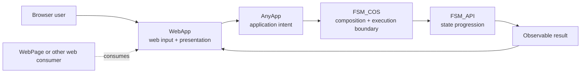

# The Singularity Workshop WebApp

> **AnyApp for the web: browser-facing inputs and interaction for FSM_COS—not another application runtime.**

WebApp is **AnyApp hosted for the web**. It accepts web-based content and browser input, composes the requested Experience through FSM_COS, and presents observable state back through web UI. The existing Windows/WPF AnyApp is a sibling host—not a desktop service WebApp must depend on. WebApp must not own a parallel meaning or lifecycle for an Experience.

## 🟦 01 What

A focused web-facing adapter: browser UI, user input, browser capabilities, and the safe translation of browser events into application-level requests.

## 🟣 02 Why

WebApp is the web host manifestation of the AnyApp role, not a client that forwards browser activity to the desktop executable. Web content and browser inputs flow through the web host into FSM_COS; the same application intent should remain meaningful when the manifestation changes.

## 🩵 03 How

WebApp receives web content and browser input, validates the Experience request and artifact identity, composes through FSM_COS, and presents results. The desktop AnyApp does the analogous job for desktop content and input. FSM_COS remains the composition/execution boundary; FSM_API provides state-machine progression. Neither host should replace those responsibilities with a competing semantic loop.

## 🟢 04 See it in a minute

The repository currently has no verified public WebApp URL, so a public demo cannot honestly be promised. [WebPage](https://github.com/TrentBest/WebPage) was built first—the chicken before the egg—and is the early web experience that should ultimately consume WebApp as its host/platform. It is useful proving-ground evidence, not the definition of WebApp's purpose.

For local verification, use the .NET 8 commands in [Development](#development). The current gateway → Moniker → hub vertical slice is transitional implementation, not yet proof of the intended AnyApp-for-web boundary.

## 🟪 05 Documentation and theory

[Documentation Index](docs/DOCUMENTATION_INDEX.md) · [Architecture](docs/ARCHITECTURE.md) · [Implementation Notes](docs/IMPLEMENTATION_NOTES.md) · [Security Model](docs/SECURITY_MODEL.md) · [Source-grounded runtime UML](docs/assets/webapp-anyapp-runtime-uml.svg)

The class map distinguishes existing source dependencies from the intended request/result seam, which is not yet proven end to end.

---

## Current implementation versus target

The current development implementation still creates a page FSM and 100 actor FSM contexts in `WebAppExperienceRuntime`, and advances them through a private heartbeat. That is useful as a visible prototype, but it is **not** the target architecture. The migration must replace this duplicate lifecycle with web input and presentation connected to canonical AnyApp/FSM_COS behavior, with deterministic tests proving the path.

## Development

Requires .NET 8.

    dotnet restore
    dotnet build --configuration Release
    dotnet test tests/TheSingularityWorkshop.WebApp.Tests/TheSingularityWorkshop.WebApp.Tests.csproj --configuration Release
    dotnet run

No NuGet publication or deployment is authorized by this documentation change.

## Design principle

> **Edify, don't mystify.** Show the real architecture in action; don't substitute a static imitation or a second runtime.

---

   
  <strong>The Singularity Workshop</strong> 
  <em>If a picture is worth a thousand words, what is a living picture worth?</em> 
  <a href="https://github.com/TrentBest">GitHub</a> · <a href="https://www.patreon.com/TheSingularityWorkshop">Support the Workshop</a>

