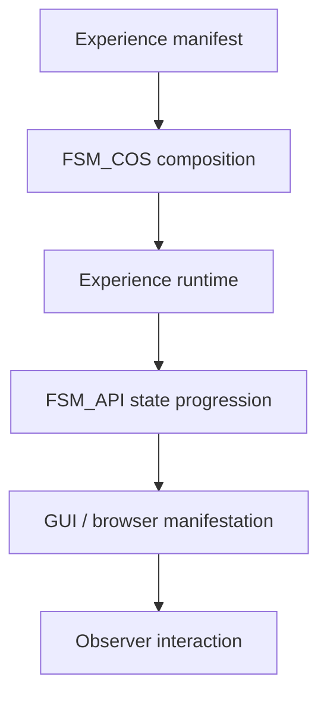

# The Singularity Workshop WebApp

> **A browser host for Workshop Experiences—not a replacement for their runtime or composition boundaries.**

WebApp turns a manifest-backed Workshop Experience into a browser-facing session while keeping presentation, FSM progression, and composition responsibilities separate.

## 🟦 01 What

It owns the browser host and interaction surface. Experience semantics stay in the Experience artifacts, state progression remains FSM_API-driven, and composition remains an FSM_COS responsibility.

## 🟣 02 Why

A browser host is most useful when it proves that an Experience can reach people without moving composition logic or Experience semantics into the web layer. Keeping those boundaries explicit makes the browser one manifestation of the Workshop, not a competing runtime.

## 🩵 03 How

A host presents the Experience; FSM_API drives state progression; FSM_COS composes capabilities; GUI and browser adapters manifest the result.

## 🟢 04 See it in a minute

**Visitor path and contributor path are not the same thing.** This repository does not currently document a verified public WebApp URL, so it would be misleading to promise a no-install, no-shell public demo here.

The browser-host proving ground is [WebPage](https://github.com/TrentBest/WebPage). Its development README records the current local browser journey and links to the automated Chromium smoke-test evidence. That is a contributor verification route—not yet a public deployment claim.

For local verification of this WebApp host, use the .NET 8 commands in [Development](#development). The expected journey is gateway → Moniker → hub; the architecture and implementation notes distinguish current behavior from the remaining runtime migration.

## 🟪 05 Documentation and theory

[Documentation Index](docs/DOCUMENTATION_INDEX.md) · [Architecture](docs/ARCHITECTURE.md) · [Implementation Notes](docs/IMPLEMENTATION_NOTES.md) · [Security Model](docs/SECURITY_MODEL.md)

---

## Detailed guide

The public browser manifestation of **The Singularity Workshop**.

WebApp is a host and proving ground: it presents Workshop Experiences in the browser while relying on the ecosystem's actual runtime and composition boundaries rather than recreating them.

## Current vertical slice

The current development line demonstrates:

- a responsive Workshop gateway;
- explicit entry into a live Experience;
- FSM_API-driven page progression;
- independently instantiated living actors sharing a processing group;
- FSM_COS composition through a host-owned MicroBundle catalog;
- Moniker → gravity → hub progression;
- a responsive browser manifestation.

The current host retains a temporary local Moniker compatibility bundle (BundleId 3101) until the canonical Experiences artifact is published and verified for consumption.

## Architecture

The essential direction is:

**WebApp → FSM_API / FSM_COS → MicroBundleDomain → host-owned or published MicroBundles**

WebApp owns browser presentation and interaction. It does not become FSM_COS, a repository, a desktop runtime, or the owner of Experience semantics.

## Documentation

The documentation layer lives under [`docs/`](docs/DOCUMENTATION_INDEX.md).

Start with:

- [Documentation Index](docs/DOCUMENTATION_INDEX.md)
- [Architecture](docs/ARCHITECTURE.md)
- [Implementation Notes](docs/IMPLEMENTATION_NOTES.md)
- [Experience Manifestation Theory](docs/EXPERIENCE_MANIFESTATION_THEORY.md)
- [Roadmap](docs/ROADMAP.md)
- [Security Model](docs/SECURITY_MODEL.md)

External packages own their own detailed theory and API documentation. WebApp documents how it uses those abstractions.

## Development

Requires .NET 8.

    dotnet restore
    dotnet build --configuration Release
    dotnet test tests/TheSingularityWorkshop.WebApp.Tests/TheSingularityWorkshop.WebApp.Tests.csproj --configuration Release
    dotnet run

No NuGet publication is performed by this repository without explicit release approval.

## Design principle

> **Edify, don't mystify.**

The browser should make the Workshop understandable by showing the real architecture in action—not by replacing that architecture with a static imitation.

---

   
  <strong>The Singularity Workshop</strong> 
  <em>If a picture is worth a thousand words, what is a living picture worth?</em> 
  <a href="https://github.com/TrentBest">GitHub</a> · <a href="https://www.patreon.com/TheSingularityWorkshop">Support the Workshop</a>

