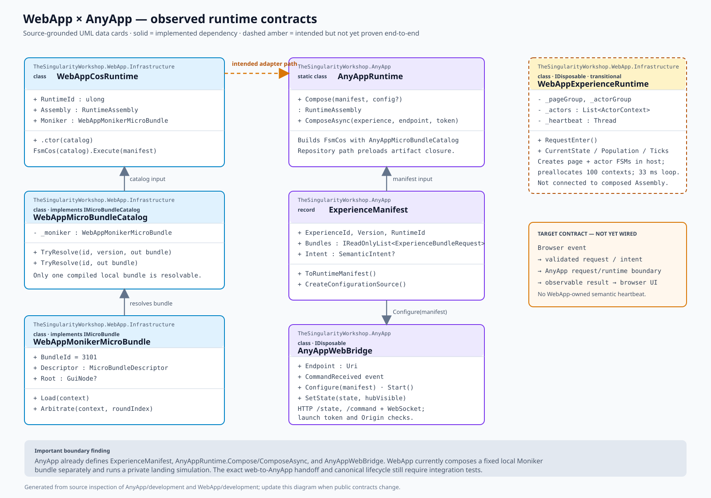
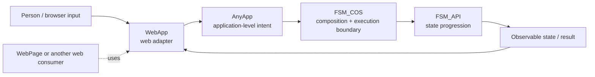

# WebApp Architecture

## Purpose




**WebApp is AnyApp for the web.** Its job is to give the Workshop's application/composition boundary a browser-facing surface: web-based user input, browser events and capabilities, and presentation of observable results.

It is an adapter—not a second application runtime, not an alternative composition engine, and not the owner of Experience semantics or lifecycle. The existing bridge SVG describes a safety boundary; it does not mean WebApp should take over the execution behind that boundary.

## Intended direction



The key contract is the request/result boundary. WebApp translates browser interactions into defined application requests and renders resulting state. It must not implement a parallel semantic lifecycle to make the page appear alive.

## Responsibilities

### WebApp owns

- browser-native input, interaction, navigation, and presentation;
- adapting browser events into explicit application-level requests;
- browser capability discovery, including Web APIs and WebXR;
- web-safe session and connection status;
- rendering observable state returned by the application/composition layer;
- safe, validated communication across a documented protocol boundary.

### WebApp does not own

- application semantics that belong to AnyApp or Experience artifacts;
- FSM_COS composition or a replacement execution loop;
- an independently invented FSM lifecycle for the canonical Experience;
- arbitrary assembly loading, code execution, filesystem commands, or a remote shell;
- the canonical artifact repository or mutation of immutable artifact identity.

## Relationship to AnyApp

**WebApp is AnyApp hosted for the web.** “AnyApp” describes the application-host role; the existing Windows/WPF AnyApp executable is one manifestation of that role, not a desktop service WebApp must depend on. WebApp must accept web-authored/web-delivered Experience content, interpret its published manifest and configuration, and compose the requested runtime through FSM_COS. It must not require the desktop AnyApp process to be running, and it must not proxy every browser interaction to that desktop process.

The shared principle is that application intent and Experience semantics stay independent of presentation. The web host supplies browser inputs and web-facing content; the desktop host supplies desktop inputs and desktop-facing content. Both hand the appropriate manifest/configuration and resolved MicroBundles to FSM_COS and present observable runtime results through their own host UI.

A request such as “enter this published Experience” is an application intent. WebApp validates the request and its artifact identity, resolves the web-delivered content, composes it through FSM_COS, then presents progress and results. It must not smuggle arbitrary code, assembly bytes, process instructions, or filesystem commands across an untrusted browser boundary.

## Relationship to FSM_COS and FSM_API

FSM_COS remains the composition and execution boundary. WebApp supplies the browser-facing inputs and presentation around that boundary; it must not create a second lifecycle owner merely because the browser needs periodic rendering. FSM_API state progression should be driven according to the canonical runtime/process-group contract, not a WebApp-owned heartbeat that becomes the semantic clock.

The exact integration contract must be proven against the current FSM_COS API and canonical Experience artifacts before the transitional runtime is removed. A successful composition call alone is insufficient evidence that the composed Experience actually executes.

### Source inspection: host-neutral contract and web content

The current AnyApp `development` branch defines `ExperienceManifest`, `AnyAppRuntime.Compose` / `ComposeAsync`, and `AnyAppWebBridge`. The manifest/runtime code is a useful reference for the intended host contract, but those types currently live in a `net8.0-windows` WPF `WinExe` project. WebApp must not reference the desktop executable as if it were a portable runtime library, and it must not treat the local `AnyAppWebBridge` as the required execution service.

The correct direction is **WebApp itself performs the web-host role**: receive web input; validate a host-neutral Experience manifest and its immutable artifact identity; resolve the referenced web-delivered MicroBundles/configuration; compose them through FSM_COS; and present state/results in the browser. Extract or reuse the manifest and request/result contracts in a host-neutral assembly if needed, without making the web host depend on desktop UI or desktop lifecycle. The desktop AnyApp and WebApp are sibling host manifestations over the same composition architecture, not a client/server pair by default.

The current WebApp `WebAppCosRuntime` composes only its local `WebAppMonikerMicroBundle`, while `WebAppExperienceRuntime` separately creates and ticks its own page/actor FSMs. Neither path yet proves manifest-driven web content composition followed by canonical Experience execution. That end-to-end path is the central migration target.

## Relationship to WebPage

WebPage is a consumer/proving ground for web experiences, not the architectural definition of WebApp. Avoid moving WebPage-specific information architecture, landing-page choreography, or a showcase simulation into the WebApp package's core purpose.

## Artifact identity

Where WebApp presents or requests a published artifact, preserve its immutable identity:

```
BundleId + Version + ContentHash
```

Resolve and validate manifests, verify content hashes, and fail closed when the requested artifact cannot be validated. Do not silently mutate identity or substitute a local demo artifact as if it were canonical.

## State and observability

Keep distinct facts distinct:

- **discovered** — an identity is known;
- **available** — required artifacts can be resolved and validated;
- **requested** — the browser submitted an explicit action;
- **running** — the canonical runtime reports active execution;
- **completed / failed** — the canonical runtime reports an outcome;
- **connected** — an optional companion/protocol connection is established;
- **immersive-capable / immersive-active** — browser/device capability and session state.

These are observations of a lifecycle, not permission for WebApp to own it. Browser rendering may refresh on its own schedule; semantic progression must follow the canonical runtime contract.

## Current migration gap

The current `WebAppExperienceRuntime` creates page and actor FSMs in host code, preallocates 100 actor contexts, and advances them on a private 33 ms heartbeat. Its Moniker → gravity → hub choreography is a transitional prototype. It does not yet satisfy the intended “AnyApp for the web” role and must not be treated as proof of canonical Experience execution.

Before removing it, add deterministic, observable integration tests that prove:

1. browser input becomes the expected application-level request;
2. FSM_COS composes the intended Experience from canonical artifacts;
3. the composed Experience actually progresses under its proper runtime owner;
4. WebApp renders the resulting state without independently driving semantic lifecycle;
5. invalid input, unavailable artifacts, disconnects, and failures are surfaced safely.

## Design principle

> WebApp is the web-facing adapter—not the application, not the composition engine, and not a competing runtime.
