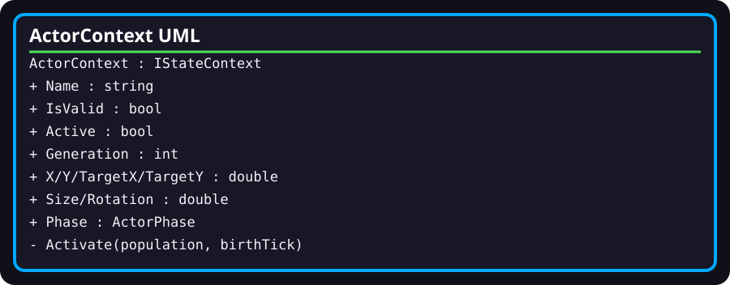

# WebAppExperienceRuntime.ActorContext

- **Fully qualified name:** `TheSingularityWorkshop.WebApp.Infrastructure.WebAppExperienceRuntime.ActorContext`
- **Kind:** public sealed nested class implementing `IStateContext`
- **Source:** [`Infrastructure/WebAppExperienceRuntime.cs`](../../Infrastructure/WebAppExperienceRuntime.cs)

## Responsibility

Carries one actor's FSM context and simulation state. Its constructor is internal, so callers outside the containing runtime cannot directly create instances through the declared constructor.

## Surface and behavior

- Implements `Name` and `IsValid` from `IStateContext`.
- Public observations include `Active`, `IsRoot`, `Generation`, `BirthTick`, `Lineage`, `X`, `Y`, `TargetX`, `TargetY`, `Size`, `Rotation`, `GravityVelocity`, and `Phase`.
- Several simulation properties have internal setters; `Active`, `IsRoot`, `Generation`, `BirthTick`, and `Lineage` have private setters.
- `Activate(population, birthTick)` assigns root/offspring state, initial size and phase, and target placement. Non-root target placement uses the local Squirrel3-style integer mixing function for deterministic jitter.
- The nested `ActorPhase` enum defines the phase values used by this context.

## Relationships and limits

The containing runtime creates and updates these contexts and passes them to FSM_API instances. The type is not a standalone simulation engine and does not own a thread or processing group. The implementation's internal helper methods and all behavior are visible in the linked source.

## Verification

The current tests assert 100 independently allocated contexts initially inactive and root activation after entry. They do not exhaustively verify every geometry, phase, or deterministic-placement invariant.
