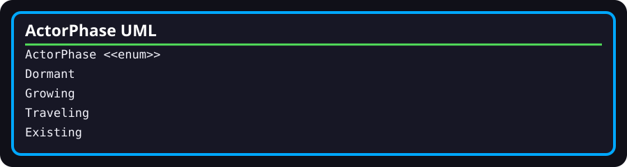

# WebAppExperienceRuntime.ActorPhase

- **Fully qualified name:** `TheSingularityWorkshop.WebApp.Infrastructure.WebAppExperienceRuntime.ActorPhase`
- **Kind:** public nested enum
- **Source:** [`Infrastructure/WebAppExperienceRuntime.cs`](../../Infrastructure/WebAppExperienceRuntime.cs)

## Responsibility

Names the phases used by `ActorContext` and advanced by `WebAppExperienceRuntime.AdvanceActor`.

## Values

- `Dormant` — initial state for preallocated non-root contexts.
- `Growing` — size interpolates toward the mature size.
- `Traveling` — position interpolates toward the assigned target while rotation advances.
- `Existing` — the actor has reached its target; the root can trigger reproduction from this phase.

These meanings are derived from the current switch and activation logic, not a general contract for other Workshop packages.

## Relationships and verification

Used by the nested [ActorContext](ActorContext.md) and containing [WebAppExperienceRuntime](WebAppExperienceRuntime.md). Existing tests cover initial actor inactivity and root activation, but do not directly assert every enum transition.
