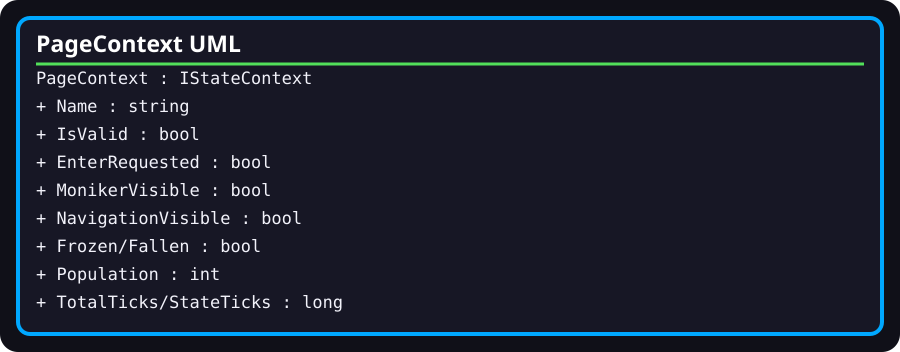

# WebAppExperienceRuntime.PageContext

- **Fully qualified name:** `TheSingularityWorkshop.WebApp.Infrastructure.WebAppExperienceRuntime.PageContext`
- **Kind:** public sealed nested class implementing `IStateContext`
- **Source:** [`Infrastructure/WebAppExperienceRuntime.cs`](../../Infrastructure/WebAppExperienceRuntime.cs)

## Responsibility

Provides the mutable page-level context consumed by the page FSM callbacks and transitions.

## Surface

- `Name` defaults to `WebAppPage`; `IsValid` defaults to `true`.
- `EnterRequested`, `MonikerVisible`, `NavigationVisible`, `Frozen`, and `Fallen` are Boolean flags.
- `Population` stores the active population count.
- `TotalTicks` tracks heartbeat ticks; `StateTicks` tracks ticks in the current choreography phase.

## Relationships and verification

The containing `WebAppExperienceRuntime` creates the context and reads/writes its fields in FSM callbacks and heartbeat logic. The current test suite checks the runtime's initial Gateway state but does not test each context field independently.
