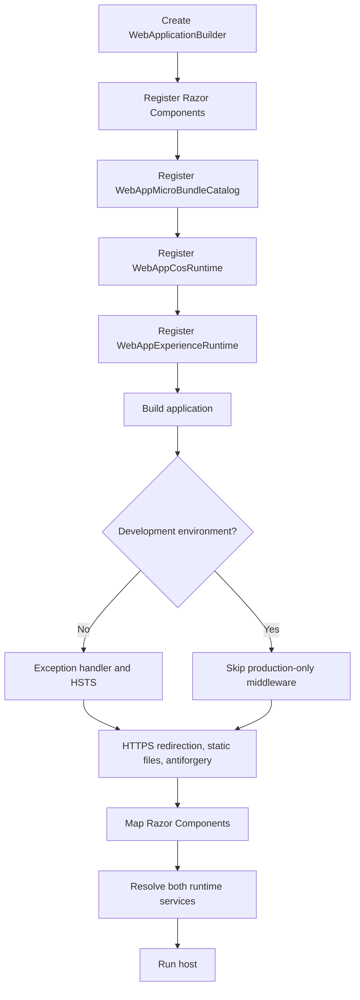

# Program.cs — application entry point

**Source:** [`Program.cs`](../../Program.cs)  
**Kind:** C# top-level statements (the source does not explicitly declare a named type).  
**Project:** `TheSingularityWorkshop.WebApp`, ASP.NET Core .NET 8 host.

## Responsibility

Builds the ASP.NET Core application, registers Razor Components with Interactive Server rendering, registers the local MicroBundle catalog and the two current runtime services, configures production exception handling/HSTS plus HTTPS/static-file/antiforgery middleware, maps the root Razor component, eagerly resolves both runtimes, and runs the host.

## Observed startup sequence

## Important constraints

- Both runtime services are registered as singletons and explicitly resolved during startup.
- `WebAppCosRuntime` composes the local Moniker MicroBundle; `WebAppExperienceRuntime` separately starts its current landing simulation and private heartbeat. Registration does not unify those paths into one manifest-driven Experience.
- The eager resolution means a construction/composition failure can fail startup.
- This source file has no explicit declared type to receive a class diagram. The flow above documents the source unit instead.

## Verification

The source file is the direct evidence for this sequence. Runtime composition assertions are in [WebAppCompositionTests](WebAppCompositionTests.md). Existing tests do not establish browser-level end-to-end behavior or canonical Experience execution.
