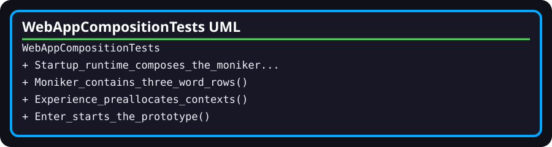

# WebAppCompositionTests

- **Fully qualified name:** `TheSingularityWorkshop.WebApp.Tests.WebAppCompositionTests`
- **Kind:** public sealed test class
- **Source:** [`WebAppCompositionTests.cs`](../../tests/TheSingularityWorkshop.WebApp.Tests/WebAppCompositionTests.cs)
- **Test framework:** xUnit

## Purpose

Records the current automated regression assertions for startup composition, the Moniker tree structure, preallocated actor contexts, and entry into the prototype living Experience.

## Test inventory

1. `Startup_runtime_composes_the_moniker_through_fsm_cos` — checks runtime ID, one assembly bundle, resolved bundle identity, and non-null root.
2. `Moniker_contains_the_three_expected_word_rows` — checks the three child row IDs.
3. `Experience_preallocates_independent_living_actor_contexts` — checks 100 inactive actor contexts and initial Gateway state.
4. `Enter_starts_the_fsm_driven_living_experience` — requests entry, waits for root activation, and checks root identity and a bounded population count.

## Evidence limits

These tests do not establish browser-level end-to-end behavior, accessibility, malicious request handling, repository artifact materialization, public NuGet compatibility, or canonical manifest-driven Experience execution. The last test accommodates asynchronous prototype timing rather than asserting a deterministic complete state progression.
