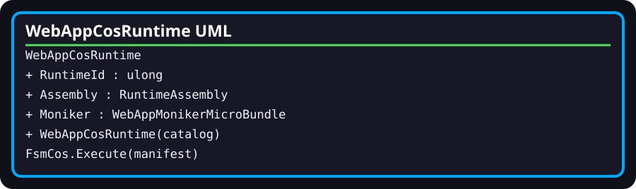

# WebAppCosRuntime

- **Fully qualified name:** `TheSingularityWorkshop.WebApp.Infrastructure.WebAppCosRuntime`
- **Kind:** public sealed class
- **Source:** [`Infrastructure/WebAppCosRuntime.cs`](../../Infrastructure/WebAppCosRuntime.cs)
- **Assembly/project:** `TheSingularityWorkshop.WebApp`

## Responsibility and boundary

Composes a fixed runtime manifest through FSM_COS and exposes the resulting `RuntimeAssembly` and verified local Moniker bundle. It is a small startup composition adapter, not the WebApp Experience executor or semantic tick owner.

## Surface and behavior

- `RuntimeId`: constant `3101001`.
- Constructor: rejects a null catalog, creates a manifest containing the local Moniker bundle (versioned entry for repository-source builds; unconfigured dependency request for package builds), and calls `new FsmCos(catalog).Execute(manifest)`.
- The constructor verifies that the assembly contains a `WebAppMonikerMicroBundle` and that its `Root` is non-null. Otherwise it throws `InvalidOperationException`.
- `Assembly`: the resulting `RuntimeAssembly`.
- `Moniker`: the resolved `WebAppMonikerMicroBundle`.

## Relationships

- Directly constructs `FsmCos` and `RuntimeManifest`.
- Receives `WebAppMicroBundleCatalog` as constructor input.
- Reads the `RuntimeAssembly` and retrieves the `WebAppMonikerMicroBundle` from it.
- This composition path does not include the fixed page/actor FSM simulation in `WebAppExperienceRuntime`.

## Verification

See [`WebAppCompositionTests.cs`](../../tests/TheSingularityWorkshop.WebApp.Tests/WebAppCompositionTests.cs), specifically `Startup_runtime_composes_the_moniker_through_fsm_cos`. That test asserts the runtime ID, one composed bundle, bundle identity, and non-null root; it does not assert manifest-driven arbitrary Experience execution.
