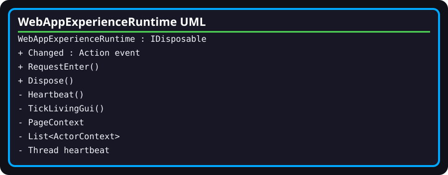

# WebAppExperienceRuntime

- **Fully qualified name:** `TheSingularityWorkshop.WebApp.Infrastructure.WebAppExperienceRuntime`
- **Kind:** public sealed class implementing `IDisposable`
- **Source:** [`Infrastructure/WebAppExperienceRuntime.cs`](../../Infrastructure/WebAppExperienceRuntime.cs)
- **Project:** `TheSingularityWorkshop.WebApp`

## Responsibility and current status

Implements a fixed landing-page simulation using FSM_API: Gateway → LivingGui → Moniker → Gravity → Running, plus up to 100 living-actor contexts. This is the current transitional prototype, **not** the canonical manifest-driven Experience runtime described by the target architecture.

## Important members and behavior

- Constructor creates page and actor processing groups, defines the page and actor FSMs, creates one page context and 100 actor contexts, then starts a background thread named `WebApp.ExperienceHeartbeat`.
- `RequestEnter()` sets the entry request under a lock, immediately updates the page group, and raises `Changed`.
- `Heartbeat()` increments the page tick count, updates the page group, raises `Changed`, and sleeps for approximately 33 ms. Exceptions inside the loop are swallowed after a delay; thread interruption exits the loop.
- `TickLivingGui()` separately updates the actor processing group and recounts active actors until the population is frozen.
- Public observations include `Actors`, `CurrentState`, `EnterRequested`, `MonikerVisible`, `NavigationVisible`, `Population`, and `Ticks`.
- `Dispose()` marks the runtime disposed, cancels/interupts the heartbeat, destroys the actor and page FSM definitions for their groups, and disposes the cancellation token source.
- The runtime uses a lock for selected operations, but callers should not infer that every exposed mutable actor property or event callback is globally synchronized.

## Nested types

- [`ActorContext`](ActorContext.md) stores actor state and deterministic placement/growth/reproduction values.
- [`ActorPhase`](ActorPhase.md) represents Dormant, Growing, Traveling, and Existing phases.
- [`PageContext`](PageContext.md) stores page-level FSM state and flags.

## Architectural caution

This class is currently the duplicate host-owned lifecycle identified in [Architecture](../ARCHITECTURE.md) and [Implementation Notes](../IMPLEMENTATION_NOTES.md). Do not interpret the use of FSM_API as proof that canonical Experience lifecycle ownership has been established. The migration plan requires a verified canonical execution owner and deterministic integration evidence before replacing this prototype.

## Verification

[WebAppCompositionTests](WebAppCompositionTests.md) checks initial state/context count and that requesting entry activates the root actor. These are narrow prototype tests, not browser journey tests or proof of canonical runtime ownership.
