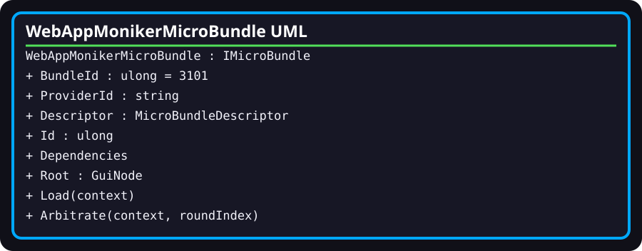

# WebAppMonikerMicroBundle

- **Fully qualified name:** `TheSingularityWorkshop.WebApp.Infrastructure.WebAppMonikerMicroBundle`
- **Kind:** public sealed class implementing `IMicroBundle`
- **Source:** [`Infrastructure/WebAppMonikerMicroBundle.cs`](../../Infrastructure/WebAppMonikerMicroBundle.cs)

## Responsibility

Builds a local GUI tree for the Workshop Moniker as a MicroBundle. This is presentation content, not a canonical Experience root or lifecycle owner.

## Surface and behavior

- `BundleId` is `3101`; `ProviderId` is `workshop-moniker`.
- `Descriptor` declares version `1.0.0` and one provider.
- `Id` delegates to `Descriptor.Id`; `Dependencies` is an empty list.
- `Load(context)` rejects a null context, builds the Moniker panel/tree and stores its root in `Root`.
- `AddLine` creates one row for each of THE, SINGULARITY, and WORKSHOP, assigning CSS classes from a six-color cycle.
- `Arbitrate(context, roundIndex)` rejects a null arbitration context and returns `false`; the current bundle does not request further arbitration changes.

## Relationships and limits

It implements `IMicroBundle`, creates GUI builder nodes using `GuiBuilder`, and is resolved by `WebAppMicroBundleCatalog`. Its root is a GUI model; this class does not host a browser, run the page FSM, or materialize repository artifact bytes.

## Verification

The tests assert that FSM_COS composes this bundle and that the resulting root contains the three expected word rows. They do not verify hosted rendering, accessibility-tree behavior, or animation.
